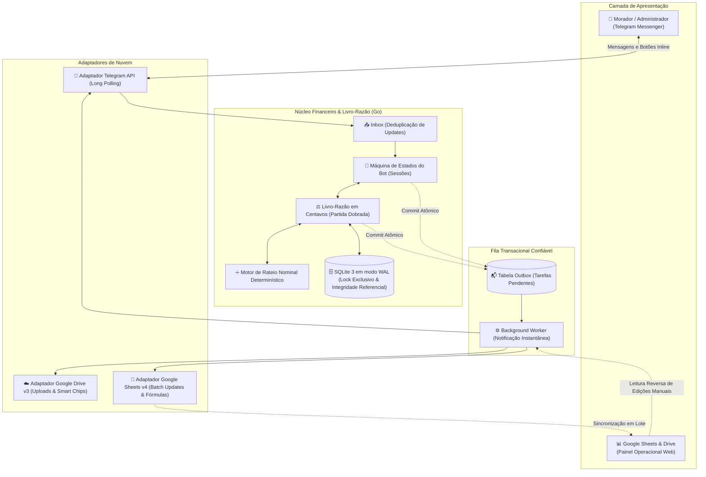

# 🏛️ RepControl • Architecture & Technical Showcase

> **Engine de Gestão Financeira Autônoma e Auditoria Contábil para Moradias Compartilhadas e Repúblicas**  
> Desenvolvido em **Go (Golang 1.25+)**, com **SQLite em modo WAL** como autoridade contábil canônica, interface conversacional de alta fidelidade no **Telegram**, projeções operacionais bidirecionais no **Google Workspace (Sheets & Drive)** e arquitetura de entrega garantida com **Transactional Outbox**.

---

> [!IMPORTANT]
> ### 🔒 Nota de Licenciamento & Propriedade Intelectual
> Este repositório é uma vitrine técnica contendo a documentação de arquitetura, especificações de engenharia de software e demonstração de funcionalidades do sistema **RepControl**. O código-fonte principal é fechado/proprietário por motivos de conformidade financeira e segurança de regras de negócio.

---

## 📌 1. Visão Geral do Sistema

O **RepControl** foi desenvolvido para solucionar a desorganização financeira crônica de repúblicas estudantis e moradias compartilhadas. O sistema substitui mensagens informais em grupos, comprovantes soltos e planilhas despadronizadas por um **motor contábil transacional, auditável e em tempo real**.

### Pilares de Engenharia:
- **Precisão Financeira Estrita (Sem Ponto Flutuante):** Valores monetários são processados como **inteiros de 64 bits em centavos (`int64`)**, eliminando qualquer imprecisão de arredondamento IEEE-754. O algoritmo de rateio (`Split`) calcula cotas nominais distribuindo o resto centavo a centavo deterministicamente.
- **Autoridade Contábil Canônica Local:** O banco de dados local **SQLite (modo WAL)** é a única fonte da verdade contábil. As planilhas do Google Sheets atuam como interfaces operacionais e projeções visuais espelhadas em segundo plano.
- **Sincronização Assíncrona Bidirecional de Baixa Latência:**
  - **Latência Zero no Telegram:** Comandos do Telegram gravam no banco e respondem imediatamente. A sincronização com a Google Sheets API ocorre de forma assíncrona via fila Outbox com canal direto de despacho (`WakeWorker`), eliminando esperas de rede nos handlers do bot.
  - **Proteção contra Sobrescrita (Pull-Before-Push):** Antes de atualizar ou projetar novas linhas no Google Sheets, o motor de sincronização lê e reconcilia alterações manuais feitas pelo administrador na planilha, impedindo sobrescritas acidentais.
  - **Coalescência de Tarefas:** Múltiplas requisições simultâneas deduplicam tarefas pendentes para o mesmo mês, respeitando as cotas de taxa da API Google.
- **Interface Telegram em Cartões Monoespaçados UTF-8:** Relatórios, extratos e guias são renderizados em caixas monoespaçadas com caracteres de borda UTF-8 (`┌`, `─`, `│`, `└`) alinhadas pixel-perfect via contagem de runas (`utf8.RuneCountInString`), garantindo legibilidade perfeita no celular e no computador.
- **Telas de Confirmação Obrigatórias:** Nenhuma obrigação ou saída financeira é processada sem aprovação explícita em cartão de confirmação prévio (`[✅ Confirmar ...]`, `[❌ Cancelar]`).
- **Navegação Universal:** Todos os submenus e respostas contêm o botão inline `[⬅️ Voltar ao Menu]`, eliminando becos sem saída no fluxo conversacional.
- **Categorização Rígida de Contas da Casa:** Despesas compartilhadas da residência são classificadas obrigatoriamente entre **Água**, **Internet**, **Aluguel**, **Energia** e **Caixa (IPTU)**, com validação de unicidade (apenas 1 conta de cada categoria por mês) e registro no histórico com User ID `CASA`.

---

## 🏗️ 2. Arquitetura de Software e Fluxo de Dados

A arquitetura segue rigoroso isolamento em camadas desacopladas:



---

## 💬 3. Funcionalidades da Interface Conversacional

### 3.1. Experiência do Morador
O morador interage pelo Telegram em um chat privativo com acesso imediato às suas informações financeiras:

```text
┌──────────────────────────────────────────┐
│  REPCONTROL • MENU DO MORADOR            │
│  Olá, Ana Lima!                          │
├──────────────────────────────────────────┤
│  [📋 Relatório completo]                 │
│  [🛍️ Minhas compras   ]                 │
│  [💰 Quanto tenho a pagar]               │
│  [💸 Solicitar pagamento]                │
│  [📊 Extrato dos meus pedidos]           │
│  [💳 Pagar valor mensal]                 │
│  [🕘 Histórico         ]                 │
│  [❓ Ajuda & Guia      ]                 │
└──────────────────────────────────────────┘
```

#### Recursos Destacados:
1. **📋 Relatório Completo (`/relatorio`):**
   Exibe o resumo consolidado da competência atual com as 5 contas da casa rateadas, o total de compras pessoais e o montante a pagar:
   ```text
   ┌────────────────────────────────────────┐
   │ RELATÓRIO DO MORADOR                   │
   │ Morador: Ana Lima                      │
   │ Competência: 2026-10                   │
   ├────────────────────────────────────────┤
   │ CONTA DA CASA (RATEIO)                 │
   │ - Água:                       R$ 33,00 │
   │ - Internet:                   R$ 44,00 │
   │ - Aluguel:                   R$ 566,00 │
   │ - Energia:                    R$ 70,00 │
   │ - Caixa (IPTU):              R$ 100,00 │
   ├────────────────────────────────────────┤
   │ COMPRAS PESSOAIS                       │
   │ - Total em Compras:          R$ 300,00 │
   ├────────────────────────────────────────┤
   │ TOTAL A PAGAR:             R$ 1.113,00 │
   └────────────────────────────────────────┘
   [🛍️ Ver compras detalhadas] [⬅️ Voltar ao Menu]
   ```

2. **🛍️ Minhas Compras (`/compras`):**
   Lista detalhada de compras pessoais pagas no mês com data, descrição, valor e chave Pix utilizada:
   ```text
   ┌────────────────────────────────────────┐
   │ COMPRAS PESSOAIS - 2026-10             │
   │ Morador: Ana Lima                      │
   ├────────────────────────────────────────┤
   │ 15/10 - R$ 100,00                      │
   │ Desc: Farmácia Remédios                │
   │ Pix: farmacia@pix.com                  │
   ├────────────────────────────────────────┤
   │ 15/10 - R$ 100,00                      │
   │ Desc: Mercado Semanal                  │
   │ Pix: mercado@pix.com                   │
   ├────────────────────────────────────────┤
   │ 15/10 - R$ 100,00                      │
   │ Desc: Livros Faculdade                 │
   │ Pix: livraria@pix.com                  │
   ├────────────────────────────────────────┤
   │ TOTAL EM COMPRAS:            R$ 300,00 │
   └────────────────────────────────────────┘
   [📋 Ver relatório completo] [⬅️ Voltar ao Menu]
   ```

3. **💸 Solicitação de Pagamento Pessoal (`/solicitar`):**
   Assistente passo a passo para envio de boleto ou despesa pessoal para pagamento pelo administrador, com tela de confirmação formal antes do enfileiramento na Outbox.

4. **💳 Pagamento Mensal (`/pagarmensal`):**
   Disponibilizado após o fechamento da competência, com envio do comprovante bancário (print ou PDF) e chave Pix da casa.

---

### 3.2. Painel de Controle Administrativo
O menu principal do administrador oferece operações de alta velocidade com atalhos de 1 clique:

```text
┌──────────────────────────────────────────┐
│  REPCONTROL • PAINEL ADMINISTRATIVO      │
│  Caixa: R$ 15.635,00 | Mês: 2026-10      │
├──────────────────────────────────────────┤
│  [🏠 Registrar conta paga]               │
│  [🧾 Meu gasto já pago   ]               │
│  [💸 Pendências & Comprovantes]          │
│  [👥 Cadastros           ]               │
│  [💰 Saldos & Devedores  ]               │
│  [📅 Fechamento do mês   ]               │
│  [🔄 Sincronizar planilha]               │
│  [❓ Ajuda               ]               │
└──────────────────────────────────────────┘
```

#### Fluxos Administrativos em Destaque:
1. **🏠 Registro de Conta da Casa Já Paga (`/contapaga`):**
   - Seleção de categoria por botões: **Água**, **Internet**, **Aluguel**, **Energia** ou **Caixa (IPTU)**.
   - Validação de unicidade (apenas 1 despesa de cada categoria por mês).
   - Rateio automático em partes iguais centavo a centavo entre moradores ativos.
   - Cartão de confirmação obrigatório antes da gravação no razão contábil.
   - Atualização imediata do histórico da planilha com User ID `CASA`.

2. **🧾 Meu Gasto Já Pago (`/gastopago`):**
   - Registro de compra pessoal do administrador paga com dinheiro da casa.
   - Débito contábil exclusivo no cadastro do administrador (sem rateio).
   - Confirmação formal prévia com visualização em cartão monoespaçado.

3. **🔄 Sincronização Sob Demanda (`/sync`):**
   - Disparo forçado de reconciliação com o Google Sheets e retorno do link oficial da planilha.

---

## 📊 4. Estrutura do Google Sheets & Dashboard

O RepControl projeta a saúde financeira da residência no Google Sheets utilizando Smart Chips nativos (`chipRuns`) e fórmulas dinâmicas:

- **Aba Dashboard (Painel Executivo):**
  - **Filtros Dinâmicos:** Menus suspensos para filtrar por **Morador** e **Estado** ("Todos", "Pago", "Não pago").
  - **Métricas Chave (KPIs):** Caixa da Casa, Total a Pagar, Total Recebido e Restante a Receber.
  - **Tabela "Detalhe por Morador" (Capacidade para até 10 Moradores):**
    Colunas: `Morador`, `Água`, `Internet`, `Aluguel`, `Energia`, `Caixa (IPTU)`, `Compras` e `Total`. As cotas de contas da casa são calculadas dinamicamente e a coluna Compras totaliza os pedidos pessoais daquele morador.
  - **Detalhamento de Compras Pessoais:** Relação completa de compras efetuadas com data, descrição, valor e chave Pix do recebedor.
- **Aba `resumo`:** Projeção calculada em tempo real de saldo devido e recebido por morador.
- **Aba `Historico pag`:** Registro definitivo de saídas de caixa com Smart Chips clicáveis dos comprovantes no Google Drive (User ID = `CASA` para contas rateadas).
- **Aba `pagamentos recebidos`:** Registro de entradas bancárias com comprovantes conferidos.

---

## 🛠️ 5. Especificações Técnicas e Decisões de Engenharia

| Componente | Tecnologia | Decisão Arquitetural |
|---|---|---|
| **Linguagem Principal** | **Go (Golang 1.25+)** | Binário estático único sem dependências (`CGO_ENABLED=0`), alto rendimento e consumo de apenas ~16 a 25 MB de RAM. |
| **Banco de Dados** | **SQLite 3 (WAL Mode)** | Autoridade contábil canônica local com integridade referencial, lock de processo exclusivo (`flock`) e latência zero de rede inter-processos. |
| **Interface Conversacional** | **Telegram Bot API** | Padrão Long Polling seguro (sem portas abertas no firewall), eliminando superfícies de ataque externo. |
| **Planilhas e Nuvem** | **Google Sheets & Drive APIs** | Escopo restrito `drive.file`, Smart Chips nativos e atualização em lote (batching). |
| **Padrão de Resiliência** | **Transactional Outbox & Inbox** | Deduplicação de mensagens na entrada e despacho confiável na saída com retentativas e backoff exponencial. |
| **Criptografia & Backups** | **AES-256-GCM + VACUUM INTO** | Snapshots atômicos cifrados enviados ao Google Drive com retenção automática e CLI de restauração independente. |
| **Sandboxing de Servidor** | **Linux Systemd Sandbox** | Executado sob usuário restrito sem privilégios (`NoNewPrivileges=true`, `ProtectSystem=strict`, `UMask=0077`). |

---

## 📄 6. Informações de Licenciamento & Contato

- **Status:** Em produção contínua em servidores Linux.
- **Licenciamento:** Proprietário / Código Fechado.

---

*RepControl • Engine de Gestão Financeira Autônoma e Auditoria Contábil.*
