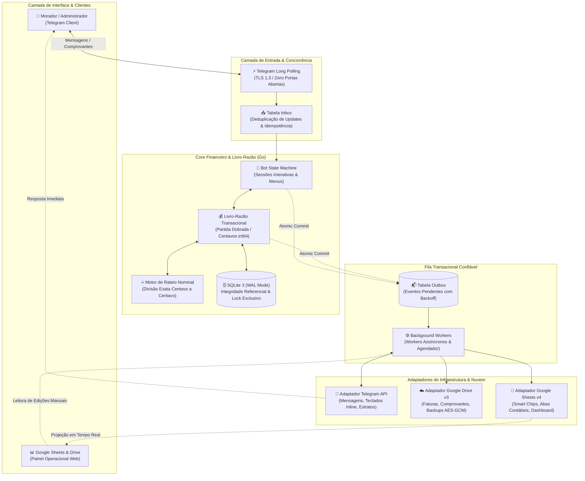
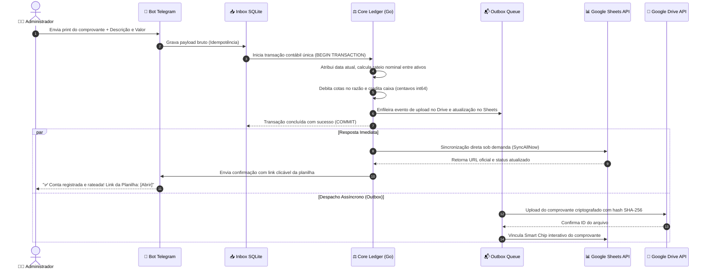

# 🏛️ RepControl • Architecture & Technical Showcase

> **Engine de Gestão Financeira Autônoma e Auditoria para Moradias Compartilhadas e Repúblicas**  
> Desenvolvido em **Go**, com **SQLite em modo WAL**, interface conversacional no **Telegram**, projeções bidirecionais no **Google Workspace (Sheets & Drive)** e arquitetura resiliente baseada no padrão **Transactional Outbox**.

---

> [!IMPORTANT]
> ### 🔒 Nota de Licenciamento & Propriedade Intelectual
> **Nota:** Este repositório contém apenas a documentação de arquitetura, especificações de engenharia de software e demonstração visual do sistema. O código-fonte é proprietário/fechado por questões de segurança, conformidade e regras de negócio da aplicação.

---

## 📌 1. Visão Geral do Sistema

O **RepControl** foi concebido para resolver o caos contábil de repúblicas e moradias compartilhadas, substituindo anotações manuais, mensagens dispersas e planilhas despadronizadas por um **motor contábil transacional, auditável e em tempo real**.

### Pilares de Engenharia:
- **Precisão Financeira Estrita (Sem Ponto Flutuante):** Todos os valores monetários são processados como **inteiros de 64 bits em centavos (`int64`)**. Sem erros de arredondamento IEEE-754. Divisões de despesas (`Split`) rateiam centavo a centavo nominalmente.
- **Autoridade Contábil Canônica:** O banco de dados local **SQLite (modo WAL)** é a autoridade canônica imutável. As planilhas Google atuam como interfaces operacionais e projeções visuais espelhadas em tempo real.
- **Autenticação Criptograficamente Segura:** Toda autorização e identificação de moradores baseia-se exclusivamente no **ID numérico do Telegram**. `@usernames` e nomes de tela nunca são usados como credencial, eliminando riscos de personificação.
- **Transactional Outbox Pattern:** Garante entrega e consistência de ponta a ponta sem risco de perda de mensagens ou falhas parciais em chamadas de rede externas (Telegram API, Google Sheets API v4 e Drive API v3).
- **Operação Desacoplada e Autônoma:** Binário estático compilado em Go, sem dependência de runtimes pesados (JVM, Node.js ou Python), consumindo menos de 30 MB de memória RAM em servidores Linux.

---

## 🏗️ 2. Arquitetura de Software e Fluxo de Dados

A arquitetura do sistema segue rigorosamente o isolamento de camadas, garantindo que o núcleo financeiro permaneça imutável e transacional, independente de latências de rede ou indisponibilidades temporárias de APIs externas.

### 2.1. Diagrama Geral de Arquitetura



---

### 2.2. Ciclo de Vida de uma Operação (Exemplo: Registro de Despesa Paga)

O diagrama de sequência abaixo demonstra o fluxo de ponta a ponta quando o administrador registra uma conta quitada (`/contapaga`), destacando a atomicidade local e a sincronização em tempo real:



---

## 🛠️ 3. Tech Stack & Decisões de Engenharia

| Componente / Camada | Tecnologia Adotada | Racional Técnico & Decisão Arquitetural |
|---|---|---|
| **Linguagem Principal** | **Go (Golang 1.25+)** | Compilação para binário estático único sem dependências de SO (`CGO_ENABLED=0`), alto throughput, baixo consumo de memória (~25MB) e tipagem forte. |
| **Banco de Dados Primário** | **SQLite 3 (modernc.org/sqlite)** | Executado em modo **WAL (Write-Ahead Logging)** com chaves estrangeiras ativas. Dispensa servidores de banco externos (PostgreSQL/MySQL), elimina latência de rede inter-processos e assegura ACID local estrito. |
| **Interface Conversacional** | **Telegram Bot API (Long Polling)** | O padrão Long Polling elimina a necessidade de expor portas de entrada (webhooks HTTP), tornando o servidor invisível a port scanners externos e resistente a ataques DDoS. |
| **Projeção Visual & Planilhas** | **Google Sheets API v4** | Utiliza a API oficial com suporte a **Smart Chips nativos** (`chipRuns`) vinculando comprovantes do Drive, fórmulas dinâmicas (`FILTER`, `SUM`) e abas protegidas. |
| **Armazenamento de Arquivos** | **Google Drive API v3** | Armazenamento de faturas e comprovantes bancários com controle de escopo restrito (`drive.file`) e nomes padronizados auditáveis. |
| **Padrão de Confiabilidade** | **Transactional Outbox & Inbox** | Impede perda de dados caso a conexão com as APIs do Google ou Telegram sofra timeouts. Retentativas automáticas com backoff exponencial. |
| **Criptografia & Backups** | **AES-256-GCM + VACUUM INTO** | Snapshots consistentes do banco sem travar leituras, criptografados com AES-GCM (autenticado) e enviados automaticamente para o Google Drive com controle de retenção. |
| **Hardening de Infraestrutura** | **Linux Systemd Sandbox** | Executado sob usuário sem privilégios com flags estritas (`NoNewPrivileges=true`, `ProtectSystem=strict`, `UMask=0077`, `GOMEMLIMIT=384MiB`). |

---

## ⚡ 4. Diferenciais & Fluxos Simplificados

```
┌─────────────────────────────────────────────────────────────────────────────┐
│                       FLUXOS DE OPERAÇÃO SIMPLIFICADOS                      │
└─────────────────────────────────────────────────────────────────────────────┘

  1. ONBOARDING ÁGIL (SEM E-MAIL)
     Novo Morador ──► /start ──► Digita Nome ──► Já cai na Planilha (APROVED=FALSE)
     Admin aprova ──► Ganha ID MOR-XXXXXX ──► Acesso liberado instantaneamente.

  2. COMPROVANTES SEM BLOQUEIO DE IA
     Usuário anexa Print/PDF ──► Aplica Data Atual automaticamente (time.Now())
     Admin confere botões ──► [Aprovar] [📅 Usar data atual] [✏️ Alterar valor]

  3. SINCRONIZAÇÃO EM TEMPO REAL
     Qualquer comando no Bot ──► Grava no Razão ──► Sincroniza Google Sheets
     Bot responde no chat ──► Link direto e atualizado da Planilha Google.

  4. MENU ADMINISTRATIVO ENXUTO
     Painel com 6 funções essenciais: Registrar Conta, Pendências, Cadastros,
     Saldos & Devedores, Fechamento Mensal e Sincronizar.
```

---

## 📸 5. Demonstração Visual & Telas

As demonstrações visuais abaixo ilustram a interface de usuário no Telegram e o espelhamento imediato nas Planilhas Google:

### 5.1. Menu Administrativo Enxuto & Atalhos Rápidos
Interface desenvolvida com botões inline, minimizando digitação de comandos e eliminando ruídos operacionais:

```text
┌───────────────────────────────────────────────────────────┐
│ 🏠 RepControl • Painel Administrativo                      │
│ Caixa Atual: R$ 1.840,50 | Competência: 2026-10           │
│                                                           │
│ [ 🏠 Registrar conta paga ]   [ 💸 Pendências & Comprovantes ] │
│ [ 👥 Cadastros           ]   [ 💰 Saldos & Devedores        ] │
│ [ 📅 Fechamento do mês   ]   [ 📋 Sincronizar & Planilha    ] │
└───────────────────────────────────────────────────────────┘
```

> *(Consulte a pasta [`assets/`](assets/README.md) para GIFs animados da tela em execução e capturas em alta resolução do fluxo real).*

### 5.2. Espelhamento nas Planilhas Google
O Google Sheets reflete a saúde financeira da moradia de forma limpa e padronizada:
- **`resumo`**: Projeção em tempo real de saldo a pagar e recebido por morador.
- **`Historico pag`**: Registro auditado contendo Chips Inteligentes clicáveis dos comprovantes hospedados no Google Drive.
- **`Dashboard`**: Cartões de fluxo de caixa, filtros dinâmicos por Morador e gráficos de rateio.

---

## 🛡️ 6. Segurança, Auditoria e Integridade

1. **Princípio do Privilégio Mínimo no Google Workspace:**
   - O sistema opera sob o escopo OAuth2 `https://www.googleapis.com/auth/drive.file`. Isso significa que o aplicativo **não tem acesso** a outros arquivos da conta do administrador, enxergando exclusivamente as planilhas e pastas criadas ou selecionadas por ele.
2. **Humano no Circuito (Human-in-the-Loop):**
   - Nenhuma baixa bancária ocorre de forma cega. Toda confirmação de pagamento exige conferência visual do print pelo administrador, prevenindo fraudes ou lançamentos acidentais.
3. **Resiliência a Desastres (Disaster Recovery):**
   - Caso a máquina virtual seja destruída ou reiniciada, o banco de dados pode ser restaurado a partir de qualquer backup AES-256 no Google Drive com um único comando (`repcontrol restore -drive`), restabelecendo todo o histórico em poucos segundos.

---

## 📄 7. Informações de Contato & Portfólio

Este projeto faz parte do portfólio técnico de automações avançadas em Go e sistemas distribuídos tolerantes a falhas.

- **Desenvolvido por:** Engenharia de Software e Automação
- **Status:** Em produção contínua
- **Licenciamento:** Proprietário / Código Fechado

---

*Nota: Este repositório contém apenas a documentação de arquitetura e demonstração. O código-fonte é proprietário/fechado por questões de segurança e regras de negócio.*
